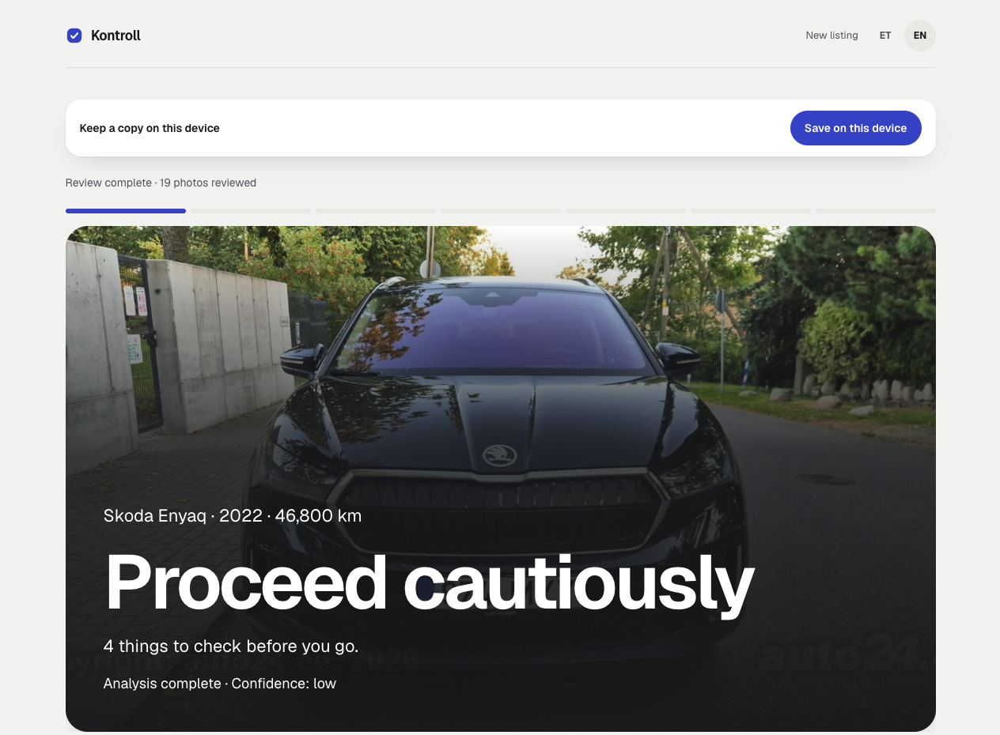
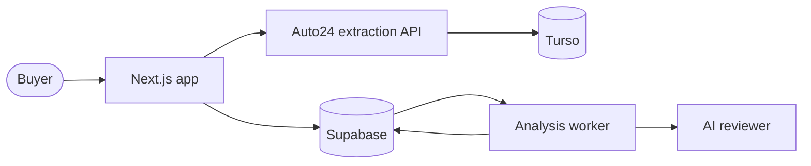

<div align="center">

# Kontroll

**Check a used car before you go see it.**

Paste an Auto24 link. Kontroll reads the listing and its photos, then writes a
private inspection report with a verdict and questions for the seller.




</div>

## How it works

1. **Paste a listing.** Kontroll captures the car details and every photo.
2. **Read the report.** AI reviews the text and up to 8 photos at once, then
   writes one verdict.
3. **Add what you learn.** Seller answers, your notes, photos or a background
   check PDF update the same report.

## Quick start

You need:

- Node 24
- pnpm
- Docker
- A [Codex](https://github.com/openai/codex) login for AI review. Without it,
  reports use baseline checks only.

```sh
git clone https://github.com/M4stas/kontroll.git kontroll && cd kontroll
pnpm install
pnpm kontroll
```

The last command sets everything up, starts the app at http://localhost:3000
and stops it on Ctrl-C. The first run builds the Docker images, which takes a
while; later runs rebuild only what changed.
[Manual setup](docs/local-development.md#run-the-whole-project-locally)

## Architecture



## Learn more

- [How it works](docs/how-it-works.md): report access, the review pipeline,
  background check PDFs and offline reports
- [Local development](docs/local-development.md): configuration, the extraction
  service, backups and tests
- [Reviewer evaluation](docs/reviewer-evaluation-guide.md)
- [Roadmap](docs/superpowers/roadmap.md)
