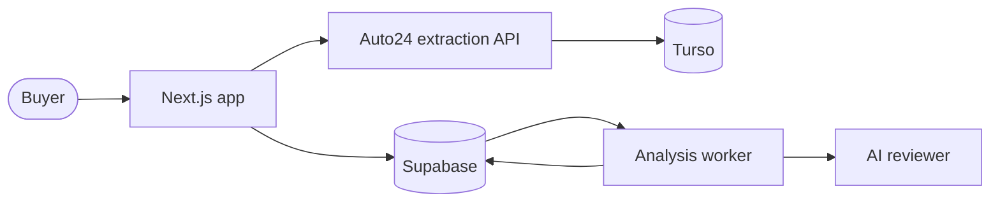
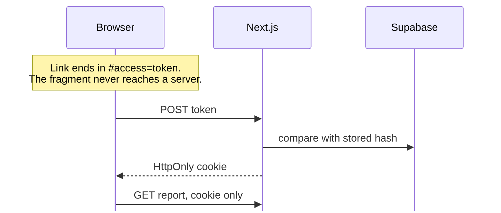

# How Kontroll works

This page explains what happens between pasting a listing link and reading the
report. [Local development](local-development.md) covers setup, configuration
and the extraction service in depth.

## Components



| Component | Role |
| --- | --- |
| Next.js | Frontend and application API |
| Analysis worker | Report reviews and supplements |
| Supabase | Report data and private uploads |
| Auto24 stack | Listing API, scraping worker, and Turso storage |

Docker Compose starts only the Auto24 stack. `pnpm kontroll` starts all of
them; to run them by hand, see
[Run the whole project locally](local-development.md#run-the-whole-project-locally).

## Reports and access

Open `/et` or `/en`, submit a listing, then open its report from the dashboard.
The dashboard stays at `/[locale]/a/[jobId]`; the report uses
`/[locale]/r/[publicId]`.



The initial report link exchanges its private token fragment for an HttpOnly
access cookie. The URL alone grants no access. Report reads and uploads require
that cookie and disable shared caching. Seller answers, buyer notes,
screenshots, and photos create a new run at the same report URL.

Keep the original link to open a report in another browser. Save a report on
this device to keep a copy for 30 days and find it on the front page. Save and
Update also renew this browser's report access cookie for 30 days. See
[Report access and limitations](local-development.md#report-access-and-limitations).

## Background check PDFs

The report has a dedicated taustakontroll PDF uploader available during photo
review and after completion. Readable PDFs remain private and are included as
unverified, page-labelled evidence in the final assessment. Completed text and
photo reviews are retained for PDF-only uploads; only the final assessment runs
again. Uploading other information keeps the existing supplement behavior.

PDFs must have selectable text, be unlocked, and fit within 12 MiB, 50 pages,
and 10,000 extracted characters (including page labels). Unreadable or oversized
documents are rejected rather than silently truncated. Embedded document
instructions are treated as source text, not reviewer instructions.

## Review pipeline


Photo review runs up to eight images concurrently per analysis alongside the text
review, for up to nine concurrent Codex calls. Final assessment waits for the text
and all selected image results to be stored, receiving text first and images in
manifest order. On a text or photo infrastructure failure, new photo work stops
and already-started reviews drain before the error is rethrown, keeping lease
renewal active through their commits. The model, reasoning effort, prompts, and
image resolution stay the same. See the
[historical performance measurements and benchmark commands](superpowers/archive/image-review-performance/checkpoint.md).

Temporary photo preparation failures retry before the worker pins a review
snapshot. Capture and review jobs retry after 15 seconds, 1 minute, and 5 minutes.
Review retries reuse committed successes. Exhausted required capture failures
stop processing without starting final assessment.

Set `DATA_REVIEW_ENABLED=false` for baseline-only reports, or configure a
supported reviewer. See the [configuration guide](local-development.md#private-analysis-reports).

## Live diagnostics

Set `LIVE_DIAGNOSTICS_ENABLED=true` on the server to open the private live review
drawer. Inspect saved text/photo/final findings and attempt timings as a review
progresses. It is off by default and needs no new migration. See the
[live diagnostics setup and timing limits](local-development.md#live-diagnostics-checkpoint-1).

## Saved reports offline

Saved reports can be reopened on the same device without a connection after
saving online. The device copy omits the background-check PDF link because
opening it requires a connection. Use a production build for service-worker
testing; see [local development](local-development.md#saved-reports-offline) for
phone HTTPS setup, browser-storage limits, and `pnpm test:e2e`.

## Development checks

```sh
pnpm test
pnpm lint
pnpm typecheck
pnpm build
```

Integration tests require a disposable local Supabase database and no live
analysis worker. See the [test instructions](local-development.md#private-analysis-reports).

Application settings live in `.env.local`; extraction keys use a private file
outside the repository (`~/.config/auto24/auto24.env`). Use independent secrets
and keep service keys server-only.
