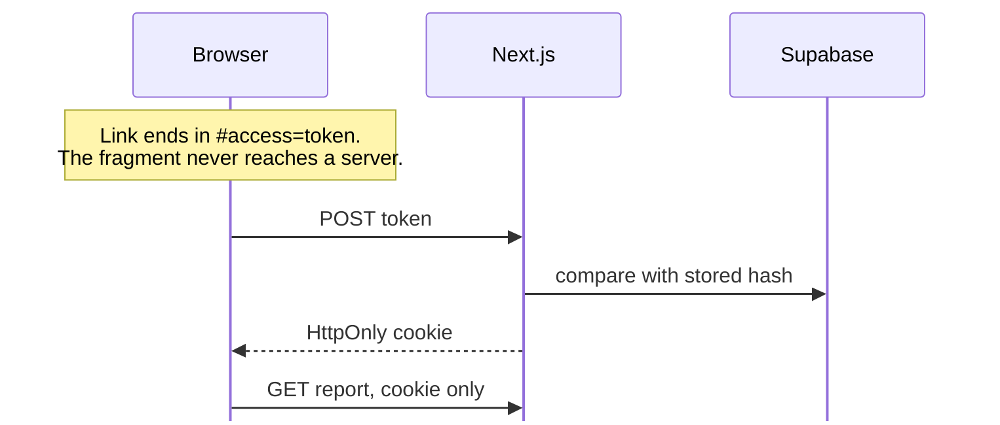
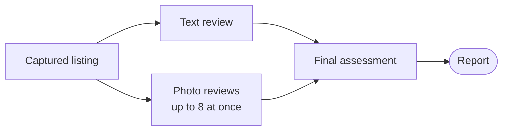

# How Kontroll works

What happens between pasting a listing link and reading the report. [Local development](local-development.md) covers setup.

## Components

| Component | Role |
| --- | --- |
| Next.js | Frontend and application API |
| Analysis worker | Report reviews and supplements |
| Supabase | Report data and private uploads |
| Auto24 stack | Listing API, scraping worker, and Turso storage |

## Reports and access

The dashboard is at `/[locale]/a/[jobId]` and the report at `/[locale]/r/[publicId]`.

The URL alone grants no access. Seller answers, buyer notes, screenshots and photos create a new run at the same report URL. See [report access and limitations](local-development.md#report-access-and-limitations).

## Background check PDFs

Readable taustakontroll PDFs stay private and enter the final assessment as unverified, page-labelled evidence. A PDF-only upload reruns only the final assessment.

PDFs must have selectable text, be unlocked, and fit within 12 MiB, 50 pages and 10,000 extracted characters, including page labels. The app rejects other files instead of truncating them. Instructions inside a document count as source text.

## Review pipeline

Final assessment waits until the text and all selected image results are stored. After an infrastructure failure, new photo work stops and started reviews finish before the error is rethrown. The [image review checkpoint](superpowers/archive/image-review-performance/checkpoint.md) has the performance measurements.

Capture and review jobs retry after 15 seconds, 1 minute and 5 minutes, and review retries reuse committed results. If a required capture runs out of retries, final assessment does not start.

## Live diagnostics

`LIVE_DIAGNOSTICS_ENABLED=true` adds a private drawer with saved findings and attempt timings. See [the setup](local-development.md#live-diagnostics-checkpoint-1).

## Saved reports offline

A report saved online reopens on the same device without a connection. The saved copy omits the background check PDF link. See [the test setup](local-development.md#saved-reports-offline).
