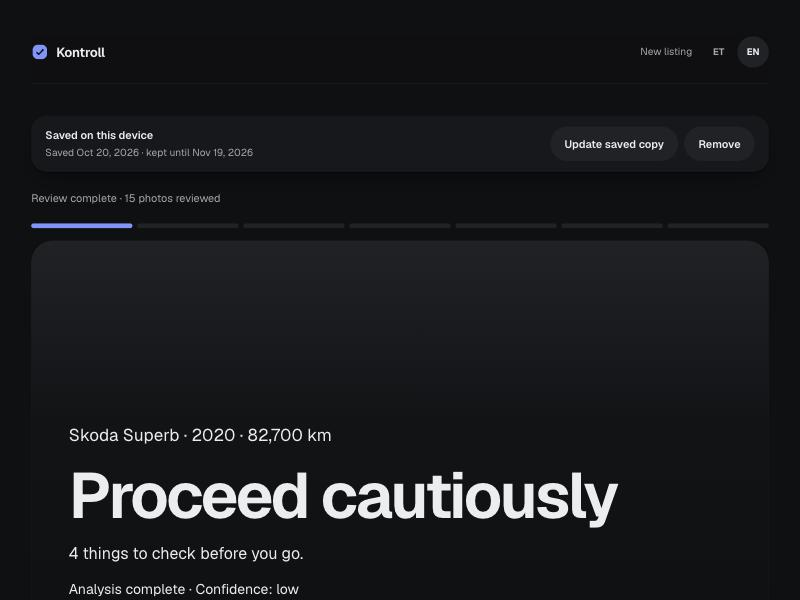
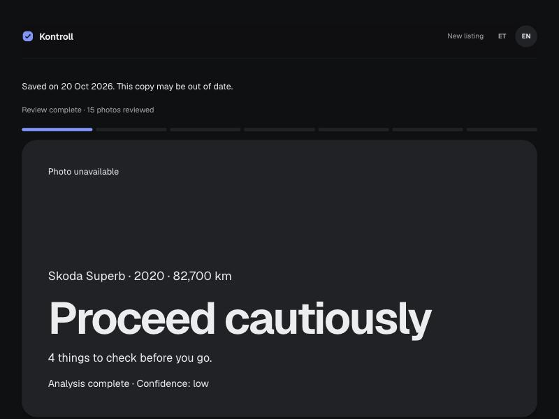
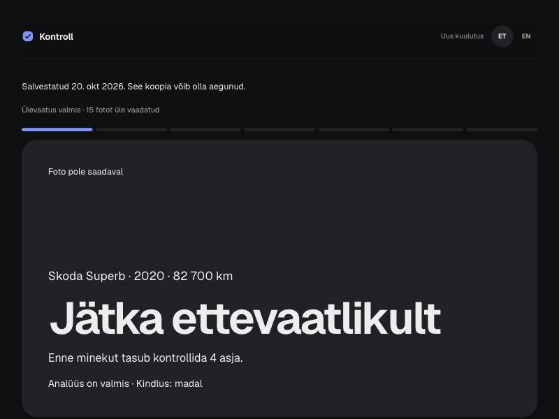
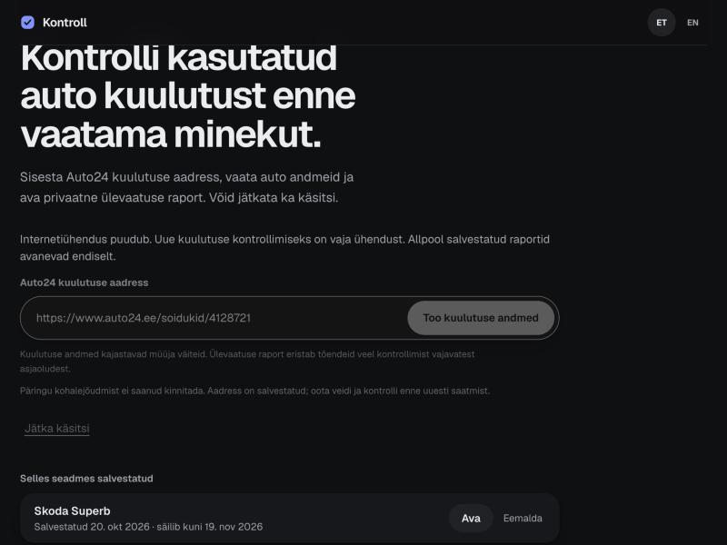

# Checkpoint 9: open saved reports offline

Execution started on 2026-10-19 after the user accepted Part A and merged
[PR #37](https://github.com/M4stas/kontroll/pull/37). Scope is Part B, Tasks 6–9 of
[the approved plan](../plans/2026-10-17-offline-reports.md), following
[the design](../specs/2026-10-17-offline-reports-design.md#checkpoint-9-open-a-saved-report-offline).

## What you will see

The front page and saved reports open without a connection. The offline front
page explains that a new listing needs a connection and disables its submission
controls. If a listing request fails because the server can't be reached, the
form stays disabled and comes back by itself within a few seconds of the server
answering. There is no retry button. Saved reports show their saved date and an
out-of-date warning; photos are unavailable. Both interface languages work.

## How to check

1. Run the production build and server, open a private report, and save it.
2. Turn on offline mode in browser DevTools and load the front page.
3. Open the saved report from its row, then load its address directly. Check the
   saved-date warning, photo placeholders, and absence of upload/retry/diagnostics.
4. Repeat the front-page and report checks in Estonian and English.
5. Close and reopen the browser while offline and repeat the loads.
6. Return online, rebuild/restart, load the front page once, and repeat offline.
7. Return online. Within a few seconds the listing form works again without
   pressing anything, and the listing is not sent a second time.

Real iPhone Safari and Android Chrome airplane-mode acceptance over HTTPS is a
user hardware check, outside the numbered implementation tasks. See local
development instructions for an HTTPS origin; a phone's HTTP LAN address is not
a secure context for service workers.

## Verification record

- Production Playwright: two tests passed against the production build and real
  service worker. Both languages, front pages, saved-row and direct report
  navigation worked offline with zero failed requests. Cached HTML contained no
  report facts or report JSON. Expiry removed only the affected report's shells.
- Unit gate: 91 files, 883 tests passed. Lint and type checking passed; lint has
  two existing warnings in redesign demo scripts. Production build passed.
- Independent whole-branch and privacy/concurrency reviews found four issues;
  the combined fix was re-reviewed clean at `fe4702e`. Regression tests cover
  pending offline preparation and retry, delayed same-report removal, offline
  recovery navigation, and form recovery after a transient fetch failure.
- Final production run: two tests passed in 32.3 seconds. Final unit run: 883
  tests passed in 91 files. Lint/typecheck passed on the fix commit.
- Internal-browser manual checks reached both localized front pages. The test
  profile had no private-report access cookie; both provided listing lookups
  returned listing-service-unavailable. A subsequent existing-report navigation
  timed out. These infrastructure/access failures do not establish offline UI
  acceptance.
- Brave/native browser checks are blocked because the Mac is locked. Browser
  restart, build update, and the full manual saved-report flow remain pending.
  Automated offline coverage does not replace those manual checks.
- This checkpoint is not accepted or ready to merge; its PR remains a draft.
  Real iPhone/Android hardware acceptance also remains pending.

### 2026-10-20

- Automatic reconnect (`85827fa`, tests `2a5fe3e`): the "Try connection again"
  button is gone. While the connection notice shows and the browser reports
  online, the form sends `HEAD /sw.js` with `no-store` every 3 seconds, aborts
  each probe after 2.5 seconds and never overlaps them. A 2xx response restores
  the form. The listing is never resubmitted. Independent review found no bugs
  and two untested guards; tests now cover both and fail when either guard is
  removed.
- Cover placeholder inset fix (`a92af88`) confirmed in screenshots below.
- Unit gate: 91 files, 891 tests passed twice. Lint (same two demo warnings) and
  typecheck passed. Production Playwright: 2 tests passed in 19.9 seconds.
- Internal-browser manual run on the production build, port 3109:
  - Captured approved listing 4128721 through the normal form. Report
    `573afbad-…` finished all 15 photo reviews. Save reached the normal saved
    state with no pending-preparation warning. The worker cached `/et`, `/en`
    and both locale report shells.
  - With the server stopped: EN and ET direct report addresses, the saved row
    and both front pages opened. Both reports showed the saved-date warning and
    the photo placeholder, with zero images and no upload, Seller replied, retry
    or diagnostics controls.
  - Reconnect, twice (before and after the worker took control): a submit with
    the server stopped showed the notice and disabled both form groups, with no
    retry button. Probes failed every 3 seconds. After restarting the server the
    form came back without a reload. Each run had exactly one listing POST.
  - Build update: a rebuild installed a new worker that cached the saved
    report's shells and waited while the old tab was open. After that tab
    closed, the new worker activated, deleted the old cache and kept the saved
    record. With the server stopped again, both locale report addresses and the
    saved row opened.
- The internal browser cannot switch to offline mode or restart, so it covered
  the network-failure path only. The user ran the Brave checks below.

### User acceptance, 2026-10-20

The user ran How to check steps 1–7 in Brave on the Mac against the production
build and reported every step passing:

- With DevTools set to Offline, both front pages showed the offline notice and
  disabled form, the saved row opened the report, and both locale report
  addresses loaded with the saved-date warning, inset photo placeholder and no
  upload, Seller replied, retry or diagnostics controls.
- After quitting Brave and stopping the server, the reopened browser loaded the
  front page and report from the saved copy.
- With the server stopped, a submit showed the notice and disabled form with no
  button. After the server restarted, the form came back within a few seconds
  without a reload, and no POST was sent after recovery. Toggling DevTools
  Offline on and off disabled and restored the form.

The user accepted checkpoint 9 and chose to skip the iPhone Safari and Android
Chrome airplane-mode checks. They have not been run.

The database integration suite is not claimed as passing. An unnecessary run
was interrupted before any test result; it is outside this checkpoint's gates.

## Decisions during implementation

- `typecheck` also builds the worker, as the spec requires; the task's script
  example omitted that step. Cost: one small additional esbuild bundle.
- Without Web Locks, skip destructive global worker/static-cache release while
  retaining removal of each report's own shells. A per-tab fallback queue cannot
  protect a concurrent save in another tab. Cost: older browsers may retain an
  idle worker/static cache after the last report is removed.

- Shared header links use document navigation so offline navigation does not
  issue unsupported RSC requests. Production tests first exposed 24 failed
  requests, then passed with none after this change. Cost: header links perform
  full document loads online instead of client transitions.

- Without Web Locks, direct deletion from all build caches is skipped; the worker
  queue handles individual shell deletion while preserving newer saves. Cost:
  orphan or failed-worker data-free shells can remain until later cleanup.
