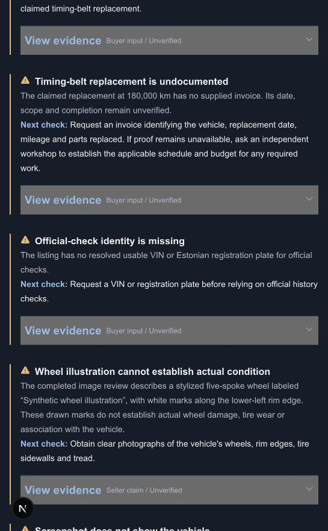
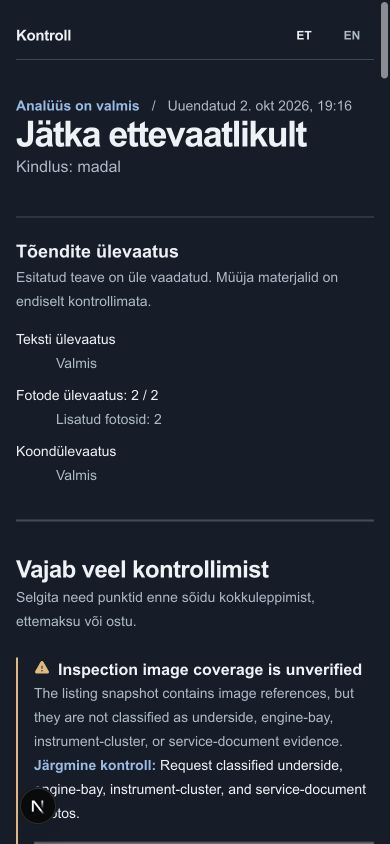
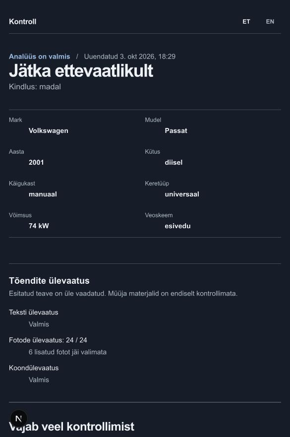
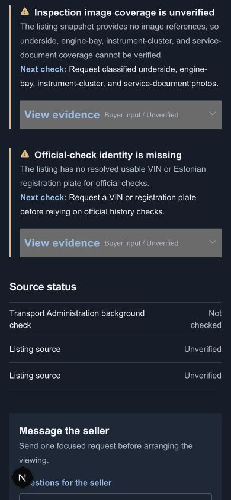

# Checkpoint 2 delivery evidence

Updated October 2, 2026. Scope follows the [approved reviewer plan](../plans/2026-09-30-used-car-data-reviewer-plan.md) and [agent policy](../../agent-policy.md).

## Implemented behavior

Private `/[locale]/r/[publicId]` reports reuse captured listings or buyer-pasted fallback text. Seller answers, pasted updates, screenshots, and private images create cumulative runs at the same URL. Evidence remains explicitly unverified; official checks remain `not_checked`. Interface language changes preserve generated report language. No offline/checklist workflow is enabled.

Review runs pin source content, locale, model/settings, prompts, and image hashes. Separate text and individual-image results commit durably before final synthesis. Retry reuses completed passes; superseded workers cannot publish or overwrite final artifacts. Developer rereview creates a fresh child run with current configuration. Database migrations are additive and preserve existing data.

The server supports OpenAI and local Codex CLI review. Codex uses existing ChatGPT authentication without a separate API key, tools disabled, isolated temporary files, bounded output and strict evidence validation. It still calls a remote model and consumes the account allowance. Tested CLI version: 0.159.2.

## Validation

- Unit suite: 358 tests across 46 files passed, bounded two-worker execution.
- Integration suite: 73 tests across 8 files passed, bounded single-worker execution against local Supabase through migration `202610020004`.
- Lint and TypeScript/route generation passed. Unauthenticated report reads and retries returned 401 with private, no-store caching. Production build passed on the final source.
- Independent subagent reviews covered schema, privacy, retry/supersession, final barriers, artifact ownership, pagination, and the final capture-refresh migration. Final focused source review returned no actionable findings after code freeze.

Actual local pipeline demo: public report `8b0fab7f-6d05-4621-a948-b0611da96e76`, English, 18 findings/actions, text complete, both private images complete, final complete. The original screenshot update failed because the SQL affected-stage allowlist omitted capture; two regression cases reproduced it, migration corrected it, and the same browser upload then succeeded. Rapid successive supplements retain original evidence ownership in baseline and enrichment.

Manual browser proof: English desktop and Estonian 390x844 mobile; no horizontal overflow; translated chrome preserves saved English conclusions; evidence expansion and seller-copy success feedback; private access fragment removed; text/JPEG updates retain the report URL; pending/failure states remain honest; no model settings or checkbox checklist. Clipboard payload is covered by unit tests; the IAB clipboard inspection does not independently expose it.

## Live model comparison

The developer selected `gpt-6.1-sol` versus `gpt-6-luna`, medium effort, identical production reviewer prompts and fixtures, local Codex provider. Sixteen text calls and two private-image calls completed with valid outputs and no model warnings. The unavailable case is a controlled no-call configuration test, not a provider outage. Saved synthetic outputs: [text comparison](checkpoint-2/reviewer-comparison.json), [image comparison](checkpoint-2/image-comparison.json).

Independent AI-assisted semantic assessment found both variants preserve attribution/uncertainty, detect conflicting mileage, request actual documents, ignore injection and fabricated citations, and use clear English/Estonian. Sol offers broader follow-ups; Luna is briefer. The labeled synthetic wheel illustration verifies image transport and appropriate uncertainty, not damage recognition on real vehicle photographs. These are not human scores. Human model-quality signoff remains open; Sol was the configured local reviewer for that comparison; the October 3 demo below uses Luna/max.

## Operational limits

Unknown models/settings fail closed. Persisted review/final publication input is bounded at 1 MiB; an oversized cumulative aggregate remains incomplete without silent truncation. Findings/actions/evidence links paginate beyond the database default 1,000 rows; regressions verify 1,025 observations and actions. Exact duplicates collapse; distinct observations from different passes remain preserved.

Future authorized source integrations, paid VIN lookup, and checkpoint 3 viewing checklist/offline save are outside this delivery.

## October 3 live Auto24 demo

The Passat report `44339c6a-a072-4ec3-b599-e2d8aa49de73` completed on run `0bcd9518-e5ac-46bc-a2a2-a2ffd9a2ad52` using the local Codex provider with `gpt-6-luna` and maximum reasoning. Text, all 24 selected listing photos, and final synthesis completed; six supplied photos remained excluded by the selection policy. One photo timeout recovered on retry without repeating saved successful passes.

Live fixes corrected Node's all-address DNS lookup callback for photo downloads, capture-run photo evidence ownership, the maximum-reasoning review deadline (300 seconds), and translated captured fact labels with kW units. Independent focused reviews found no actionable issues. The final focused regression run passed 62 tests across five files; TypeScript checks and unstaged whitespace checks passed. These checks supplement, rather than rerun, the earlier full-suite results above.

Manual browser verification confirmed completed ET and EN report chrome, preserved generated Estonian conclusions, expandable evidence, and a 390px mobile layout without horizontal overflow. The preserved per-pass findings produce repeated themes and seller questions; distinct per-pass observations are retained by the checkpoint contract. A future grouped presentation can reduce repeated themes without discarding evidence.

## October 4 review and delivery checks

Independent reviews covered the full checkpoint frontend/API, review pipeline, private image boundary, migrations, artifact ownership, retries and supersession. Verified fixes preserve earlier evidence during baseline reruns and descendant updates; reuse committed image results without storage access; recover transient capture-photo failures in a fresh developer rereview; carry pending research forward; and paginate cumulative facts, sources and evidence. PostgreSQL's committed result hash remains authoritative. The additive rereview migration has a data-preserving function rollback.

Seller supplement fixes bind retry keys to the submitted payload, disable edits while pending, prevent duplicate submission, clear rejected file selections, and enforce same-origin mutation requests. Shared image bounds accept 12 MiB/40 MP inputs and produce bounded 1600px private reviewer PNG copies. Code cleanup expands compressed control flow, removes an unused checkbox, avoids duplicate repository construction, clears successful DNS timers, and excludes generated Supabase metadata.

Final source verification: 387 unit tests across 46 files, 78 integration tests across eight files, full lint, and production build including TypeScript passed. The final independent recovery/privacy review found no remaining actionable issues. No real model calls were needed for these regressions.

Manual browser checks used a separate synthetic local report with review disabled: private-link exchange removed the token fragment, empty submission validation worked, pending controls were disabled, the seller answer was accepted, scoped processing completed at the same URL, and seller-copy feedback appeared. The 390px layout had no horizontal overflow. The actual Passat report remained text/photo/final complete; English chrome preserves its generated Estonian conclusions.

